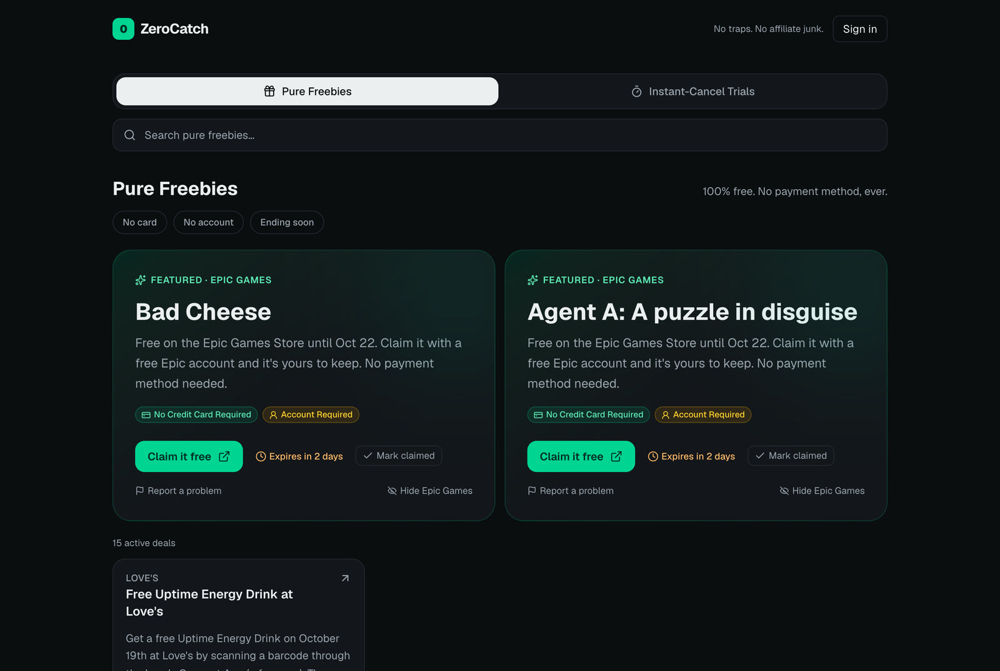
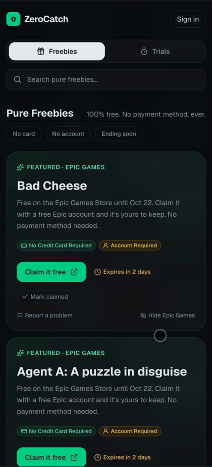
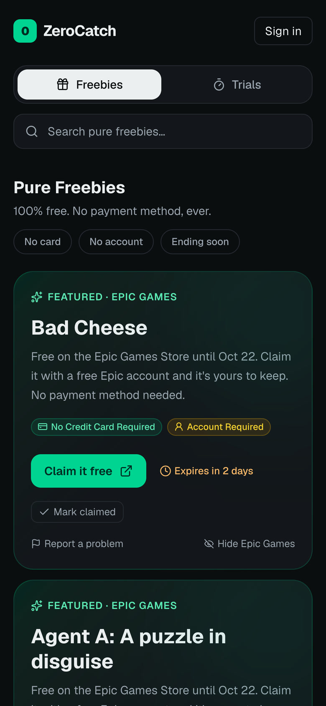
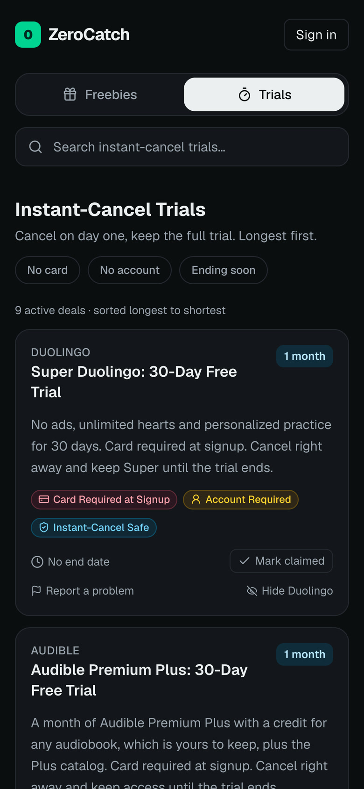
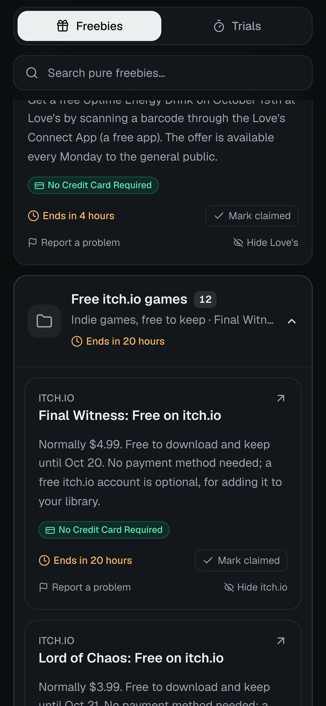
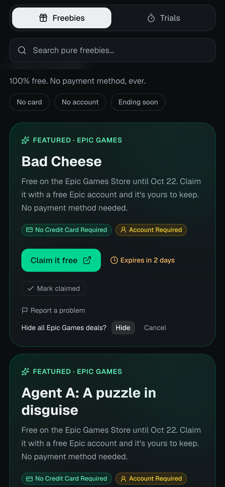
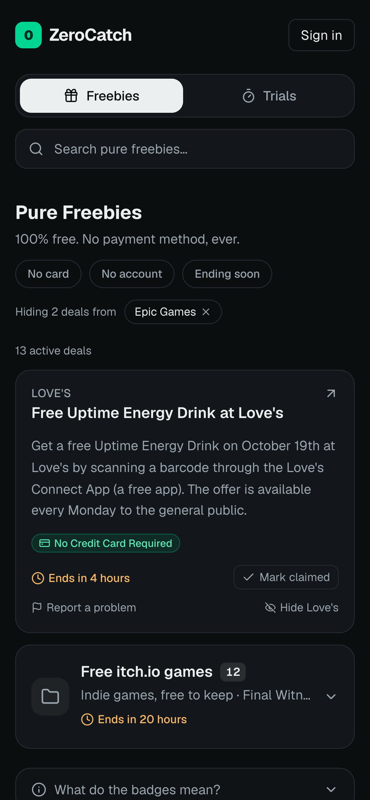
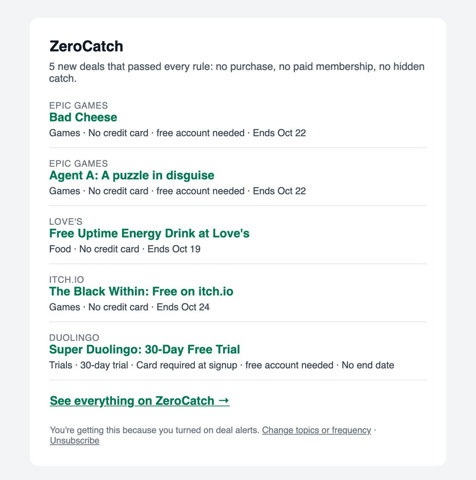

# ZeroCatch

[](https://github.com/KaiMonno/ZeroCatch/actions/workflows/ci.yml)
[](LICENSE)

**Live: [zerocatch.dev](https://zerocatch.dev)**

**Good-Faith Freebies:** a deal aggregator that only lists verified, no-strings-attached offers. No affiliate links, no "free with purchase", no trials that end the moment you cancel. New deals are found, checked and published every night with no manual work, for under $15 a year.



<!-- Demo GIFs: add docs/demo-*.gif and reference them here, e.g.  -->

## Features

| Pure Freebies | Instant-Cancel Trials | Grouped indie games |
| :---: | :---: | :---: |
|  |  |  |
| Free with no payment method. Epic's weekly games are featured. | Trials you can cancel on day one and keep for the full period, longest first. | Three or more itch.io giveaways fold into one card so they can't crowd the feed. |

| Hide a vendor | Hidden vendors | Deal-alert email |
| :---: | :---: | :---: |
|  |  |  |
| Not into a store? Hide every deal from it, signed in or not. | Hidden vendors stay out of the feed and emails; tap a chip to bring one back. | Opt-in daily or weekly digests by topic, with one-click unsubscribe. |

- **Badges on every deal:** card required or not, account required or not, instant-cancel safe, and a live countdown to the end date.
- **Search and filters in the URL** (`?tab=trials&q=…&f=no-card,ending-soon`), so every view can be shared and is rendered on the server.
- **Mark claimed:** claimed deals drop out of your feed. Works as a guest (cookie) and merges into your account when you sign in with Google.
- **Report a problem:** three separate reports in a week hide a deal until it's reviewed.
- **Installable PWA**, mobile-first dark UI.

## How it works

- **Nightly pipeline** (Python, standard library only, on GitHub Actions): official sources (Epic, Steam, GOG, itch.io), curated trial and calendar files, press releases and freebie blogs. Every fetch honors robots.txt with an RFC 9309 parser.
- **AI judge with guardrails:** blog and press leads pass keyword rules, then one structured-output call to Claude Haiku 4.5. The model can only pick the deal's link from links that match the brand in the title, so it can't invent or pick an ad URL. Only high-confidence verdicts publish, after deterministic re-checks. About $14 a year.
- **Database-enforced rules** (Supabase Postgres): check constraints (a pure freebie can never require a card), a view that filters by start and end time at query time, row-level security on every user table, and column-level grants so users can't point alert emails at someone else's inbox.
- **Next.js 16 with Cache Components:** one shared, tag-invalidated cache for the deal list, with each visitor's claims and hidden vendors applied on top per request.

| Tab | URL | What qualifies |
| --- | --- | --- |
| Pure Freebies | `/` | Free with no payment method. Account or promo code at most. |
| Instant-Cancel Trials | `/?tab=trials` | Trials you can cancel on day one and still keep the full period. Sorted longest first. |

## Stack

Next.js 16 (App Router, TypeScript, Tailwind v4) on Vercel · Supabase (Postgres, Auth) · Python scrapers on GitHub Actions · Claude Haiku 4.5 · Resend · installable PWA.

## Getting started

```bash
npm install
npm run dev            # works immediately on local sample data
```

To use a real database:

1. Create a free Supabase project.
2. Run each file in `supabase/migrations/` in filename order (SQL editor or `supabase db push`).
3. `cp .env.example .env.local` and fill in the URL, anon (publishable) key, service-role (secret) key, and an admin password.
4. `npm run seed` upserts the 8 sample deals. It's idempotent because rows are keyed on `source_key`.

Sample deals in `src/data/seed-deals.ts` are illustrative. Verify each one's real terms before publishing it.

## Data model

`public.deals` holds the source of truth. Constraints enforce the feed's rules:

- `pure_freebie` rows can never require a credit card.
- `free_trial` rows must have `trial_duration_days`.
- URLs must be `https://`.

`public.active_deals` is a `security_invoker` view of deals that have started and haven't expired. It is the **read contract** for every client.

Row-level security allows `SELECT` for the anon role only. Writes go through the service-role key, used by the seed script and the scrapers.

## What qualifies

The public rules are on the site at `/what-qualifies`. A deal is listed only if it's free with **no purchase of any kind**, or an instant-cancel trial, and is none of: points/credit/gift cards, free shipping or delivery, gated behind a paid membership, a rebate or cash back, limited quantity, an in-store event, for one audience only, a contest, or a roundup. The scrapers enforce these in `scrapers/classify.py` (each rejection is logged with its reason code), and the database blocks the retired `free_with_purchase` category.

## Lead pipeline: mostly hands-off

```
Vercel Cron (~midnight PT) ─▶ GitHub Actions ─▶ scrapers/ ─▶ alert emails (Resend)
  ├─ trusted: published directly ────────────────────────────────────▶ deals ─▶ site
  │    Epic · Steam (no DLC) · GOG · itch.io · trials.toml · fixed-date calendar
  ├─ judged: keyword rules ─▶ Claude Haiku 4.5 verdict ─▶ guardrails ─▶ deals
  │    PR Newswire · I Crave Freebies · Money Saving Mom · Instagram   (AI_JUDGE_MODE: off / shadow / publish)
  └─ review queue (/admin/review): variable-date calendar entries, judged leads while the judge is off
Visitors: "Report a problem" ─▶ 3 distinct reporters in 7 days hide a deal
```

| Source | Handling |
| --- | --- |
| Epic Games | Auto-published as hero. Next week's games are inserted early with a future `starts_at`, so the hero turns over on schedule |
| `scrapers/data/trials.toml` | The file is the approval: listed trials publish, removed ones unpublish |
| `scrapers/data/food_calendar.toml` | Recurring free days: food, plus National Park fee-free days, Free Comic Book Day and Museum Day. Fixed-date entries publish 21 days ahead (hidden until the day); "~" entries go to the queue to confirm the year's date |
| Steam free-to-keep | Auto-published if Steam's API says it's a full game (DLC excluded); unpublished the night it leaves the free list |
| GOG giveaway | Auto-published; unpublished the night the homepage banner is gone |
| itch.io sale feed | 100%-off games with an original price of at least $3.99 auto-publish, using the feed's exact `saleends` date |
| PR Newswire, Instagram brand accounts | Inclusion rules, then the AI judge (or the review queue while the judge is off) |
| I Crave Freebies, Money Saving Mom | Feeds (robots.txt and terms permit it) → rules → strict brand-link match → AI judge → auto-publish |
| Hip2Save | Paused: ~1% of posts qualified |

**AI judge** (`scrapers/judge.py`): one structured-output call per *new* lead (posts are never re-judged). It returns a verdict against the inclusion rules plus cleaned-up title, description, dates and an index into the links found in the article. It can't invent a URL. Deterministic guardrails then re-check dates, categories and the no-card rule, and only `high` confidence verdicts publish. A duplicate guard skips a deal whose brand link is already live. `AI_JUDGE_MODE` is a repository variable: `shadow` (default) records verdicts on the queue for comparison, and `publish` acts on them. Without an `ANTHROPIC_API_KEY` secret the judge is off. Expected cost at ~6 new leads/day is about $14/year.

**Reports:** every deal card has "Report a problem" (rate-limited to 5/hour per visitor, using salted IP hashes, so no IPs are stored). Three distinct reporters within a week hide the deal until an admin unhides or unpublishes it at `/admin/deals`.

- **Scrapers:** `python -m scrapers` (`--dry-run` to preview; `--dry-run --judge` also calls the AI). Robots.txt is honored on every fetch.
- **Instagram:** `python -m scrapers.instagram --check` reports, for each brand in `scrapers/data/instagram_brands.toml`, whether the account was found and which recent posts look like freebies. Needs `INSTAGRAM_ACCESS_TOKEN` + `INSTAGRAM_USER_ID` (Meta Graph API business discovery, Standard Access, no App Review).
- **Manual workflow options:** Actions → Scrape leads → Run workflow → `judge_check` (AI verdicts on current leads) or `instagram_check` (Instagram report). Neither writes anything.
- **Scheduling:** Vercel Cron (`vercel.json`, free plan: within the hour) calls `/api/cron/scrape`, which starts the scrape workflow through GitHub's API. GitHub's own `schedule` stays as a backup, since it can run hours late. Needs `CRON_SECRET` and `GITHUB_DISPATCH_TOKEN` in Vercel.
- **Housekeeping** (`run_housekeeping()`, nightly): auto-rejects leads pending for 14 days, deletes deals expired over 90 days ago, prunes login-failure records.
- **Admin auth:** single password, HMAC-signed cookie, lockout after 5 failed attempts per IP in 15 minutes.
- **Tests:** `python -m unittest discover -s scrapers/tests -t .`

## Project layout

```
src/app/              home feed (tabs via searchParams), account, login, auth callback, unsubscribe, what-qualifies
src/app/admin/        review queue + published deals: password login, server actions, shared deal form
src/app/api/          cron trigger for the nightly scrape, one-click unsubscribe
src/components/       DealCard, HeroCard, DealFolder, TabNav, SearchBar, FilterChips, claim/hide/report controls
src/lib/deals.ts      the only deal data-access module (cached Supabase query + local fallback)
src/lib/claims.ts     who's viewing: claims and hidden vendors from the account or guest cookies
supabase/migrations/  SQL migrations (run in filename order)
scrapers/             Python sources, AI judge, alert sender, unit tests; data/*.toml curated lists
docs/screenshots/     README images
.github/workflows/    CI (typecheck, lint, build, tests) and the nightly scrape
```

## Roadmap

| Phase | Scope | Status |
| --- | --- | --- |
| 1 | Web MVP: two tabs, badges, search and filters, PWA | Done |
| 1.5 | Data pipeline: scrapers, AI judge, curated trials and calendar, reports | Done (AI judge publishing) |
| 3 | Accounts, "Mark claimed", hidden vendors, deal-alert emails | Done |
| 2 | Expo mobile app on the same Supabase backend | Planned |

### Refresh schedule

GitHub Actions cron runs in UTC.

| Job | Cron (UTC) | Local time | Why |
| --- | --- | --- | --- |
| Daily refresh | `5 8 * * *` | 12:05am PST / 1:05am PDT | Picks up new deals overnight for every US time zone. Midnight Eastern would publish next-day deals at 9pm Pacific. |

Deals appear and disappear on time no matter how often scrapers run, because `active_deals` filters on `starts_at` and `expires_at` at query time. That's why Epic needs no Thursday run: next week's games are already stored with their start time. The schedule only controls how quickly brand-new deals are discovered.

### Accounts and "Mark as claimed" (built)

- **Sign in with Google** (Supabase Auth via `@supabase/ssr`): `src/proxy.ts` refreshes the session on each request, and server code checks it with `getClaims()`. `/login` starts the OAuth flow, and `/auth/callback` exchanges the code (redirects are limited to same-site paths).
- **Claims:** "Mark claimed" on any deal hides it from that visitor's feed, and "Show N claimed" brings it back with Undo. The deal list stays one shared cache, and each visitor's claims are filtered on top of it per request.
- **Guests:** claims are kept in an httpOnly cookie (up to 80) that the server reads, so there's no flicker on first render. On sign-in they merge into the account and the cookie is cleared.
- **Database:** `deal_claims` has RLS so users can only read and change their own rows. `my_active_deals` hides the caller's claims, ready for the Expo app.

### Hidden vendors (built)

- **"Hide <vendor>"** on any deal (with a one-tap confirm) hides every deal from that merchant, e.g. all itch.io games. Hidden vendors show as chips above the feed and on `/account`; tapping a chip brings them back.
- Works like claims: guests keep up to 25 vendors in an httpOnly cookie (URI-encoded, since names can contain commas) that merges into the account on sign-in, and signed-in users keep them in `hidden_vendors` (RLS, own rows only). `my_active_deals` and alert emails both skip hidden vendors.

### Deal-alert emails (built)

- **Opt in on `/account`:** topics (Games, Food, Trials, Other freebies) and frequency (daily when something new matches, or weekly on Mondays). Only signed-in users with a verified email can subscribe. A database trigger always sets the address from the user's own account, and column-level grants stop users from writing `email` or `last_sent_at`.
- **Sending** (`python -m scrapers.alerts`, after each nightly scrape) uses Resend's batch API from `alerts@zerocatch.dev`. A deal counts as new once it's visible, claimed deals are skipped, each subscriber gets at most one email per period, and every batch carries an `Idempotency-Key`. It's capped at 90 emails a run (Resend's free tier allows 100/day).
- **Unsubscribe:** HMAC-signed links, plus RFC 8058 one-click `List-Unsubscribe` headers that mail apps POST to `/api/alerts/unsubscribe`. Links in the email go to `/unsubscribe`, which asks before acting so link scanners can't unsubscribe anyone.
- Needs `RESEND_API_KEY` (GitHub) and the same `ALERTS_SIGNING_SECRET` in GitHub and Vercel; the send step skips quietly without them.

### Local development with Supabase

`npx supabase start` runs Postgres, Auth and the REST API in Docker and applies `supabase/migrations/`. Then:

```bash
NEXT_PUBLIC_SUPABASE_URL=http://127.0.0.1:54321 NEXT_PUBLIC_SUPABASE_ANON_KEY=<publishable key from `npx supabase status`> npm run dev
```

## Phase 2: Expo app

There is no custom API layer to rebuild. A React Native app can create a Supabase client with the same public anon key and query `active_deals` with the same filters as `src/lib/deals.ts`. RLS already keeps that key read-only. If the logic grows, the query builder in `deals.ts` can move into a shared package that both apps import.
